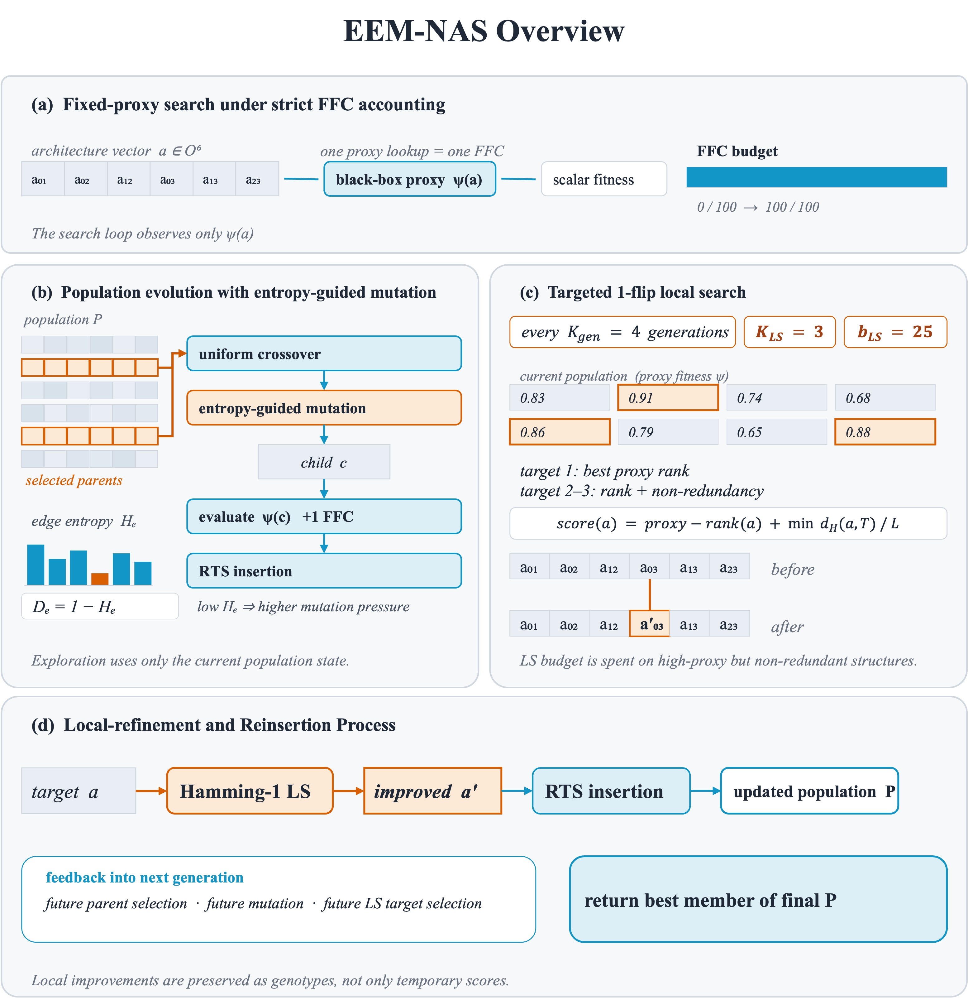

# Evaluation-Efficient Memetic NAS (EEM-NAS)

[](https://www.mdpi.com/2079-9292/15/15/3408)
[](https://doi.org/10.3390/electronics15153408)

Reference implementation accompanying the paper:

> 📄 Published in *Electronics*, 2026.
>
> **Budgeted Fixed-Proxy Search for Zero-Shot NAS via Evaluation-Efficient Memetic NAS**
> Seungyeop Kang, Wangduk Seo. *Electronics* 15(15), 3408, 2026.

---

## Paper & Publication

- **Journal:** *Electronics* (2026)
- **DOI:** https://doi.org/10.3390/electronics15153408
- **Paper:** https://www.mdpi.com/2079-9292/15/15/3408

---



EEM-NAS is a single-population memetic search procedure for **budgeted fixed-proxy zero-shot NAS** on the NAS-Bench-201 TSS search space. Each run optimizes one fixed zero-cost proxy under a strict fitness function call budget (FFC = 100), so only 100 of the 15,625 candidate architectures are queried.

This repository provides a clean reproduction of the paper's four search primitives, four budgeted fixed-proxy baselines, an online zero-cost proxy backend, and scripts/notebooks for NAS-Bench-201 experiments. In the online backend, every candidate builds the actual NAS-Bench-201 architecture and runs a real PyTorch forward/backward proxy computation on a fixed cached minibatch.

---

## Main Result (paper)

NAS-Bench-201 TSS, 8 zero-cost proxies × 3 datasets (CIFAR-10, CIFAR-100, ImageNet-16-120) × 4 baselines, FFC = 100, 100 paired seeds per cell. A win requires Holm-corrected Wilcoxon *p* < 0.05 and Cliff's δ > 0 on the final proxy score.

| vs. baseline | Win | Tie | Loss |
| --- | ---: | ---: | ---: |
| Random | 24 | 0 | 0 |
| Regularized Evolution | 23 | 1 | 0 |
| Simple Mutation | 24 | 0 | 0 |
| Generic GA | 22 | 2 | 0 |
| **Total (96 comparisons)** | **93** | **3** | **0** |

> **Proxy coverage.** All eight proxies from the paper are implemented: ZiCo, NWOT, SynFlow, Jacov, SNIP, Grad Norm, Fisher, and SWAP. The paper's search runs used precomputed proxy arrays over all 15,625 architectures. This repository computes the same proxies online, per queried architecture, so absolute proxy values can differ from the paper's arrays.

---

## Repository Layout

```text
eem-nas/
|-- README.md                       this file
|-- requirements.txt                numpy + torch + torchvision + gdown + nas-bench-201
|-- LICENSE                         MIT
|-- assets/
|   `-- overview.jpg                method overview figure
|-- notebooks/
|   `-- run_experiments.ipynb       end-to-end experiment walkthrough
|-- eem_nas/
|   |-- encoding.py                 NAS-Bench-201 TSS encoding (length-6 op vector)
|   |-- evaluator.py                FFC-bounded evaluator with proxy backend abstraction
|   |-- operators.py                tournament selection, uniform crossover, block mutation
|   |-- local_search.py             1-flip first-improvement local search
|   |-- primitives.py               RTS, rank+distance LS targets, entropy-guided mutation
|   |-- eem_nas.py                  Algorithm 1: proposed EEM-NAS method
|   |-- baselines.py                baselines and forced-edit fairness controls
|   `-- proxy/
|       |-- backends.py             online and precomputed proxy backends
|       |-- nb201.py                NAS-Bench-201 cell and backbone in PyTorch
|       |-- nb201_api.py            trained-accuracy lookup wrapper
|       |-- proxies.py              ZiCo, NWOT, SynFlow, Jacov, SNIP, GradNorm, Fisher, SWAP
|       `-- data.py                 CIFAR/ImageNet-16/random data loaders
|-- scripts/
|   |-- download_nb201.py           gdown-based NAS-Bench-201 API download helper
|   |-- run_one.py                  one method/dataset/proxy/seed experiment cell
|   `-- run_main_matrix.py          full comparison matrix driver
`-- tests/
    `-- test_eem_nas.py             smoke tests for search and online proxy backend
```

---

## Online Proxy Compute

Every candidate produced by the search loop builds the actual NAS-Bench-201 architecture from its length-6 encoding, initializes the network with the run seed, and runs the chosen zero-cost proxy on a fixed cached minibatch via PyTorch.

```python
from eem_nas.evaluator import FitnessEvaluator
from eem_nas.proxy import NB201Api, OnlineProxyBackend
from eem_nas.eem_nas import run as run_eem_nas
from scripts.download_nb201 import ensure_nb201_api

# Auto-download NAS-Bench-201-v1_1-096897.pth (~2.2 GB) on first call.
api = NB201Api(ensure_nb201_api(), datasets=("cifar10",))

backend = OnlineProxyBackend(
    proxy_name="zico",
    dataset="cifar10",
    batch_size=16,
    n_batches=2,
    device="cuda",               # or "cpu"
    data_source="torchvision",   # auto-downloads CIFAR-10/100
    init_seed=0,
    cell_seed=0,
    nb201_api=api,               # fills test_accuracy for the returned architecture
)
evaluator = FitnessEvaluator(backend, max_evals=100)
best, pop, fit = run_eem_nas(evaluator)
```

The eight supported proxies are `zico`, `nwot`, `synflow`, `jacov`, `snip`, `grad_norm`, `fisher`, and `swap`. Each proxy is implemented in `eem_nas/proxy/proxies.py`.

**SWAP** follows the official plain (unregularized) score of Peng et al. (ICLR 2024), with the setting used in the paper. Every post-ReLU unit defines a binary activation pattern over an m = 64 input batch, the score is the number of distinct patterns, and it is averaged over five N(0, 1) Gaussian weight re-initializations. When `batch_size` is not given, SWAP uses 64 samples and every other proxy uses 16. On a GPU one full-size NAS-Bench-201 network takes about 0.6 s.

The NAS-Bench-201 `.pth` file is used only to look up the trained test accuracy of the returned architecture. It is not used by the search loop and does not provide proxy scores.

---

## Required Data

| What | How to get it | Used for |
|---|---|---|
| `NAS-Bench-201-v1_1-096897.pth` (~2.2 GB) | `python -m scripts.download_nb201` | trained test accuracy lookup |
| CIFAR-10 / CIFAR-100 | auto-downloaded by torchvision on first use | proxy compute batches |
| ImageNet-16-120 (~3.7 GB) | download from the [NAS-Bench-201 README](https://github.com/D-X-Y/NAS-Bench-201), unpack it, then pass `--imagenet16_root <path>` | proxy compute batches for `imagenet16_120` |

For a quick sanity run without external data, use `--data_source random` to evaluate proxies on synthetic Gaussian batches. The unit tests use this mode.

---

## Installation

```bash
python -m venv .venv
source .venv/bin/activate
pip install -r requirements.txt
```

On Windows PowerShell, activate the environment with:

```powershell
.\.venv\Scripts\Activate.ps1
```

Python >= 3.10 is recommended. PyTorch >= 2.0 is required.

---

## Quick Start

### Notebook

```bash
jupyter notebook notebooks/run_experiments.ipynb
```

### Single Experiment Cell

The first call downloads the NAS-Bench-201 `.pth` file if it is missing:

```bash
python -m scripts.run_one --method eem_nas --dataset cifar10 --proxy zico --seed 0
python -m scripts.run_one --method generic_ga --dataset cifar100 --proxy nwot --seed 7
```

Skip the download and trained-accuracy lookup in offline environments:

```bash
python -m scripts.run_one --method eem_nas --dataset cifar10 --proxy synflow --seed 0 \
    --no_test_accuracy --data_source random --cells_per_stage 2
```

### Full Main Matrix

The default matrix runs 5 methods x 8 proxies x 3 datasets x 100 seeds at FFC = 100. The 96 pairwise EEM-NAS-vs-baseline comparisons correspond to 4 baselines x 8 proxies x 3 datasets, matching the paper's main family.

```bash
python -m scripts.download_nb201
python -m scripts.run_main_matrix --workers 8 --seeds 100
```

For ImageNet-16-120 cells, pass:

```bash
python -m scripts.run_main_matrix --data_source imagenet16 --imagenet16_root <path>
```

Per-cell pickle files are written under `results/main_matrix/`. They contain the running best per FFC, queried-architecture history, returned architecture encoding, proxy score, and trained test accuracy when available.

---

## EEM-NAS Hyperparameters

Paper-final defaults:

| Symbol | Value | Meaning |
|---|---:|---|
| `pop_size` | 10 | population size |
| `K_gen` | 4 | local-search trigger period in generations |
| `K_LS` | 3 | local-search targets per trigger |
| `W` | 3 | RTS replacement-window size |
| `b_LS` | 25 | per-local-search-call FFC cap |
| `mutation_prob` | `1 / L = 1 / 6` | per-edge mutation rate |
| `tournament_size` | 5 | tournament selection size |
| `crossover_prob` | 0.9 | uniform crossover probability |
| `cells_per_stage` | 5 | NAS-Bench-201 backbone depth per stage |

These are the settings behind the paper's 93 W / 3 T / 0 L result over 96 comparisons.

---

## Wall-Clock Notes

Approximate timings depend on proxy, hardware, `cells_per_stage`, batch size, and data source:

- **CPU**: with the full backbone (`cells_per_stage=5`) and batch size 16, expect roughly 100 ms/FFC for SynFlow and 500 ms/FFC for ZiCo. One full EEM-NAS run at FFC = 100 usually takes about 10 seconds to 1 minute on CPU.
- **GPU**: typically 5x to 25x faster for the gradient-based proxies.
- **Caching**: the online backend caches per-encoding scores by default, so duplicate architecture queries do not rerun PyTorch. Each first-time architecture evaluation is still charged exactly one FFC.

---

## Available Baselines

```python
from eem_nas.baselines import BASELINES

best = BASELINES["aging_evolution"](evaluator)
```

Default comparison baselines:

- `random`: uniform random sampling
- `aging_evolution`: Aging/Regularized Evolution (Real et al., 2019)
- `simple_mutation`: steady-state mutation-only search
- `generic_ga`: uniform crossover + tournament selection + block mutation + elitism

Additional forced-edit fairness controls:

- `simple_mutation_forced`: Simple Mutation with at-least-one-edit fallback
- `generic_ga_forced`: Generic GA with the same forced-edit fallback

---

## Tests

```bash
python -m pytest tests/ -q
```

The test suite includes search-side smoke tests and online-backend tests that build NAS-Bench-201 cells, run every proxy, check finite outputs, run EEM-NAS at a tiny FFC budget, and verify ImageNet-16-120 routing. Tests do not require the NAS-Bench-201 `.pth` file or downloaded image datasets.

---

## Citation

```bibtex
@article{kang2026eemnas,
  title   = {Budgeted Fixed-Proxy Search for Zero-Shot {NAS} via Evaluation-Efficient Memetic {NAS}},
  author  = {Kang, Seungyeop and Seo, Wangduk},
  journal = {Electronics},
  volume  = {15},
  number  = {15},
  pages   = {3408},
  year    = {2026},
  doi     = {10.3390/electronics15153408}
}
```

---

## License

MIT. See `LICENSE`.
